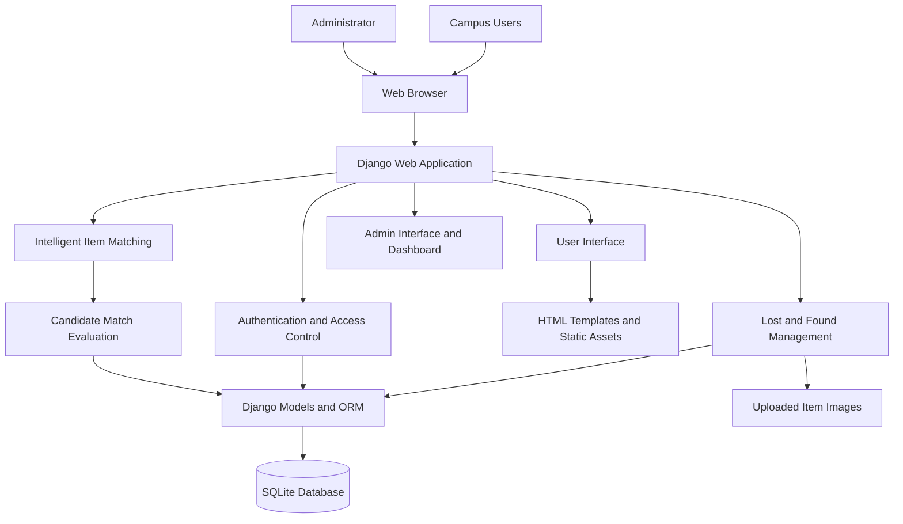
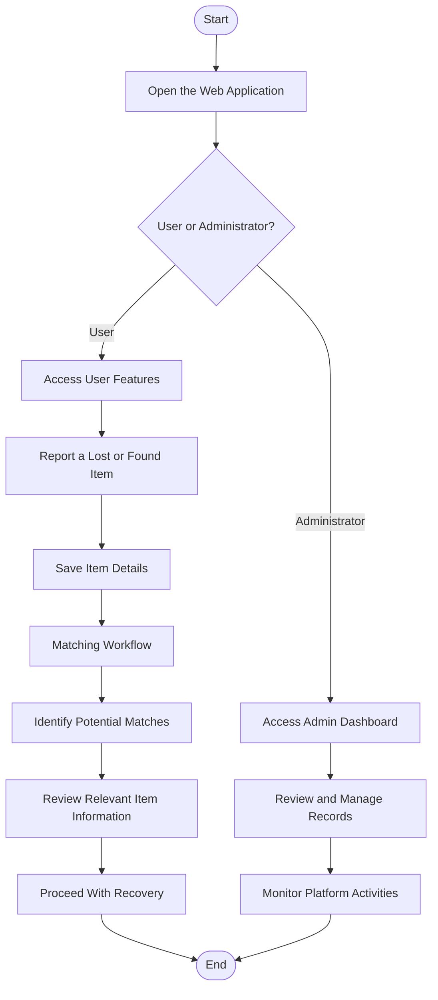

# 🎓 AI-Based Campus Lost-Item Recovery System

An intelligent, web-based platform designed to simplify the process of reporting, discovering, matching, and recovering lost belongings within a campus environment.

**Live Website:** [Campus Recovery AI](https://campus-recovery-ai.onrender.com)

## 📌 Project Overview

Losing personal belongings on a college campus can be frustrating, and identifying the rightful owner of a found item can be equally challenging. Traditional lost-and-found processes often depend on manual communication, notice boards, or searching through unorganized reports.

The **AI-Based Campus Lost-Item Recovery System** addresses this problem through a centralized web application where users can report lost and found items and discover potential matches. The system incorporates an intelligent item-matching workflow to help identify possible connections between lost-item reports and found-item reports.

The application also provides administrative functionality to support the management and monitoring of the platform.

The goal is to make campus lost-and-found management more accessible, organized, efficient, and user-friendly.

## 🎯 Objectives

* Provide a centralized platform for reporting lost and found belongings.
* Help users discover potentially matching lost and found items.
* Reduce the effort involved in manually searching for misplaced belongings.
* Maintain organized item information and associated images.
* Provide an administrative dashboard for managing platform activities.
* Improve communication and coordination in the campus recovery process.

## ✨ Key Features

### 👤 User Module

* **Lost Item Reporting:** Submit details about belongings that have been lost.
* **Found Item Reporting:** Register items found on campus to help locate their owners.
* **Item Information:** Maintain relevant information such as item descriptions, categories, dates, and images, according to the implemented forms.
* **Potential Match Discovery:** Use the intelligent matching workflow to identify possible matches between lost and found reports.
* **Item Browsing:** Explore available item reports and relevant details.
* **Recovery Assistance:** Make it easier for users to identify potentially recoverable belongings.

### 🛡️ Admin Module

* **Administrative Dashboard:** Access an overview of system information and item records.
* **Item Management:** Manage lost and found reports through the available administrative functionality.
* **Record Monitoring:** Review the information stored in the application.
* **Centralized Administration:** Support organized management of campus lost-and-found activities.

*Note: The exact actions available to administrators depend on the permissions and features enabled in the deployed application.*

## 🏗️ System Architecture

The application follows a Django-based web architecture that separates the user interface, application logic, item-matching functionality, and data storage.



### Architecture Components

| Component                         | Responsibility                                                                        |
| --------------------------------- | ------------------------------------------------------------------------------------- |
| Presentation Layer                | Displays pages, forms, item listings, and dashboards to users.                        |
| Django Application Layer          | Handles HTTP requests, routing, business logic, and responses.                        |
| Authentication and Access Control | Supports account-related functionality and permission-controlled access.              |
| Item Management Module            | Processes and manages lost-item and found-item reports.                               |
| Intelligent Matching Module       | Evaluates reported item information to identify potential lost-and-found matches.     |
| Data Access Layer                 | Uses Django models and the ORM to interact with stored records.                       |
| Database Layer                    | Stores structured application data. The project includes SQLite for database storage. |
| Media Storage                     | Holds uploaded item images used by the application.                                   |
| Administrative Interface          | Supports administrative monitoring and management tasks.                              |

## 🔄 System Workflow



### How the Matching Process Works

1. Users submit information about lost or found belongings.
2. The application stores the submitted information.
3. The intelligent matching module evaluates relevant item details.
4. Potentially related lost and found records are identified.
5. Users can review the available information and follow the application's recovery process.

The matching system is intended to assist recovery by identifying potential matches. A suggested match should not automatically be treated as proof of ownership.

## 🧰 Technology Stack

The project uses a Python and Django-based web application stack.

| Technology       | Purpose                                                            |
| ---------------- | ------------------------------------------------------------------ |
| Python           | Core programming language and application logic                    |
| Django           | Web framework, request handling, models, and application structure |
| Django ORM       | Database operations through Python models                          |
| SQLite           | Relational database used by the project                            |
| HTML             | Web page structure                                                 |
| CSS              | Styling and presentation                                           |
| JavaScript       | Client-side interactions where implemented                         |
| Django Templates | Dynamic rendering of application pages                             |
| Media Files      | Storage of uploaded item images                                    |
| Render           | Deployment and hosting of the live web application                 |
| Git and GitHub   | Source-code version control and project collaboration              |


## 🌐 Live Deployment

The application is deployed on Render and can be accessed using the following link:

**[Launch Campus Recovery AI](https://campus-recovery-ai.onrender.com)**

The deployed application allows visitors to explore the available features. Some functionality may require authentication or appropriate permissions.

## ⚙️ Run the Project Locally

Follow these steps to run the Django application on your local machine.

### Prerequisites

* Python installed on your system.
* Git installed on your system.
* A terminal such as PowerShell, Command Prompt, or a Unix shell.

### 1. Clone the Repository

```bash
git clone <YOUR_GITHUB_REPOSITORY_URL>
cd <YOUR_PROJECT_DIRECTORY>
```

Replace the placeholders with your actual GitHub repository URL and project directory name.

### 2. Create a Virtual Environment

```bash
python -m venv venv
```

Activate it on Windows PowerShell:

```powershell
.\venv\Scripts\Activate.ps1
```

### 3. Install Dependencies

```bash
pip install -r requirements.txt
```

### 4. Configure Environment Variables

If the application requires environment variables, configure them according to the project's settings and deployment configuration. Do not commit secret keys, passwords, or other sensitive values to GitHub.

### 5. Apply Database Migrations

```bash
python manage.py migrate
```

### 6. Create an Administrator Account

```bash
python manage.py createsuperuser
```

Follow the prompts to create an account if you need access to Django's administrative interface.

### 7. Start the Development Server

```bash
python manage.py runserver
```

Open the local application at:

http://127.0.0.1:8000/

*The commands above assume the repository contains `manage.py` and `requirements.txt` in the current directory. Follow the project's actual configuration if the directory structure or setup requirements differ.*

## 📁 Suggested Documentation Structure

Keep the screenshots organized inside your repository:

```text
your-project/
├── README.md
├── requirements.txt
├── manage.py
├── docs/
│   └── screenshots/
│       ├── user-home.png
│       ├── user-items.png
│       ├── user-report-item.png
│       ├── user-matching-results.png
│       ├── admin-dashboard.png
│       ├── admin-item-management.png
│       └── admin-records.png
├── items/
├── templates/
├── static/
└── media/
```

This is a suggested documentation layout, not a replacement for your actual Django project structure.

## 👩‍💻 Project Team

The project was developed collaboratively by the following team members.

| S. No. | Student ID | Team Member Name          | Role        |
| -----: | ---------- | ------------------------- | ----------- |
|      1 | 23BFA05008 | Appal Reddy Gayathri      | Team Lead   |
|      2 | 23BFA05057 | Chennuri Sampurna Devasri | Team Member |
|      3 | 23BFA05022 | Ballapuram Vyshnavi       | Team Member |
|      4 | 23BFA05012 | Arichetty Reddy Sravani   | Team Member |
|      5 | 23BFA05035 | Bokkisim Devi Sree        | Team Member |

## 🎓 Academic Project

**Project Title:** AI-Based Campus Lost-Item Recovery System

**Domain:** Web Development, Artificial Intelligence, and Intelligent Information Retrieval

**Application Type:** Web-Based Lost-and-Found Management System

**Deployment Platform:** Render


These are possible enhancements and should not be interpreted as existing features unless implemented.

---

Developed with dedication by the **AI-Based Campus Lost-Item Recovery System Team**.

**Live Website:** https://campus-recovery-ai.onrender.com
